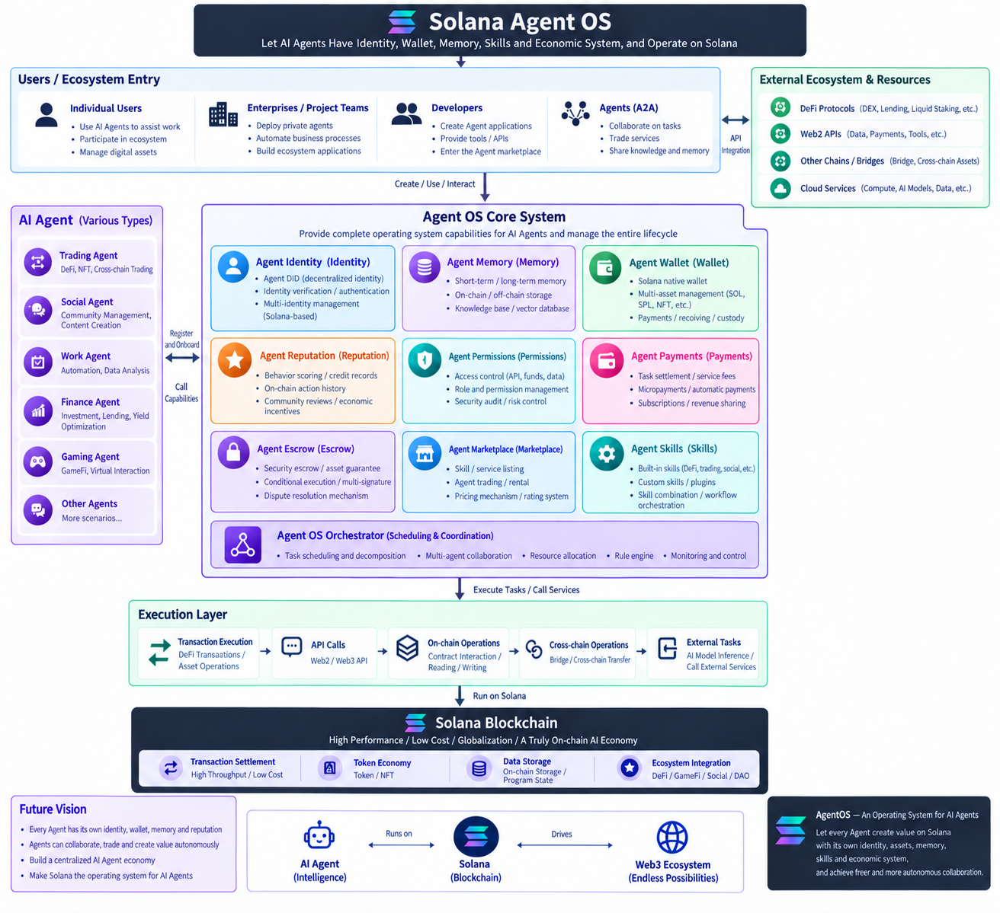

# AgentOS

AgentOS is a Solana Agent Runtime and economic kernel. The first slice in this workspace includes an Anchor protocol, a local policy-aware demo runtime, and a Wallet Standard control center.



## Run the control center

For a Chinese step-by-step guide covering local setup, web operations, payments, Worker/Judge coordination, background execution, recovery, and Devnet, see the [scenario reproduction guide](docs/SCENARIO_REPRODUCTION_GUIDE.md).

For a complete, step-by-step Devnet demonstration—including wallet setup, deployment, Agent creation, payments, Escrow settlement, optional paid Skills, Session automation, MCP inspection, and troubleshooting—see the [judge demo runbook](docs/DEMO_RUNBOOK.md).

For reproducible build provenance, deployed binary comparison, and finalized Skill/Escrow transaction collection, see [Devnet evidence collection](docs/DEVNET_EVIDENCE.md). Run `npm run build:devnet` before deployment and `npm run evidence:devnet -- --deployment-only` after deployment. Neither a build nor a deployment-only report proves that the two workflows have run.

Requirements: Node.js 20.19 or newer, npm, Rust, Solana CLI, and Anchor CLI 1.2.0.

```sh
npm install
npm run dev
```

Open <http://127.0.0.1:5173>. The runtime listens on <http://127.0.0.1:8787>. Connect a Wallet Standard compatible wallet to view its Devnet SOL balance. Task planning and trace steps are explicitly a **simulation**. When an active on-chain Skill is available, the planner can recommend it; the app then offers a separate account review and wallet-confirmed payment flow.

To enable the optional OpenAI planner, copy `apps/runtime/.env.example` to `apps/runtime/.env` and add your `OPENAI_API_KEY`. Set `OPENAI_MODEL` to a model available to your account if needed. The key stays in the local runtime process. Set `AGENTOS_PROGRAM_ID` to the deployed Devnet program address to let the Runtime and MCP read live on-chain data; `SOLANA_RPC_URL` defaults to the public Devnet RPC, and custom endpoints are checked against Devnet's genesis hash. Solana RPC requests reject redirects. RPC responses are streamed with byte caps before JSON parsing: 64 KiB for the cluster check, 2 MB for individual RPC reads, and 5 MB for program account listings. Directory reads return at most 1,000 account records, and the Agent Marketplace is capped at 100 entries. OpenAI Responses are capped at 1 MB. Before `/api/run`, the browser obtains active Skills through the Runtime's bounded Devnet directory endpoint and passes their IDs and exact asset prices as planner capabilities. The planner returns schema-constrained proposals; the runtime replaces any proposed Skill amount with the registry price and applies local SOL/USDC limits, then intersects them with the selected Agent Policy and in-memory Session's live permissions and remaining allowances when available. A supplied Session that cannot be verified disables paid proposals. `/api/run` does not pay for or invoke a Skill. The separate review flow re-reads the Skill, Agent, Policy, Session, and Vault accounts before presenting a wallet transaction.

The bounded read-only web endpoints are `GET /api/on-chain/skills`, `GET /api/on-chain/agents`, `GET /api/on-chain/executions?agent=<address>`, and `GET /api/on-chain/escrows?agent=<address>`. `POST /api/escrow/judge` optionally checks task/result text against their on-chain SHA-256 commitments before requesting an off-chain advisory from the OpenAI Responses API; it does not authorize settlement. Marketplace and Trace use these Runtime endpoints for account directories; wallet-specific reads and transaction confirmation continue through the connected Devnet RPC.

## Connect an MCP client

The local runtime exposes a stateless Streamable HTTP MCP endpoint at <http://127.0.0.1:8787/mcp>. MCP clients must run on the same machine as the runtime. The endpoint is bound to loopback and checks the request Host and Origin. It provides thirteen tools:

- `agentos_get_escrow_handoff`: reads explicitly shared task or result text and rechecks its Devnet commitments.
- `agentos_runtime_status` reports planner mode, model, and the count of locally retained simulation traces.
- `agentos_list_skills` reads public Skill entries from the configured Devnet program and returns each Skill PDA, provider, active status, and exact SOL/USDC prices.
- `agentos_list_agents` returns up to 100 public Agent accounts with owners, active status, execution and reputation counts, and total SOL/USDC volume, ranked by activity and score.
- `agentos_list_escrows` returns up to 1,000 public Escrow accounts with employer/worker Agent addresses, status, deadlines, raw asset amounts, task/result hashes, and the linked funding Execution ID when present. Legacy Escrows without that on-chain link return `null`; task text stays off-chain.
  Pending negotiations also include a validated `settlement` snapshot: proposal PDA, proposer, exact Worker/employer shares, and expiry. Missing or invalid proposal reads return `settlementReadError` while retaining the Escrow record.
- `agentos_list_executions` returns settled public payment, Skill, and Escrow Execution records, including refunded Escrows, with full input/output hashes and status; optionally filter by an Agent address and choose a result limit.
- `agentos_get_execution_transactions` verifies one completed or refunded Execution PDA and returns its latest successful, confirmed Devnet transaction signatures with Explorer links.
- `agentos_get_escrow_transactions` verifies one Escrow PDA and returns its latest successful, confirmed Devnet transaction signatures with Explorer links, current settlement status, and linked funding Execution ID when present.
- `agentos_remember_execution` saves an exact Skill or accepted Worker result locally after checking that its UTF-8 bytes match the output hash in a completed Skill or released Escrow Execution for that Agent. It does not write to chain.
- `agentos_search_memory` searches local memory by title, tags, and result text, then rechecks each returned result against its Devnet Execution commitment.
- `agentos_get_policy` reads one Agent and its Policy directly from Devnet, returning its active state, allowed actions, and exact SOL/USDC daily, per-action, spent, and remaining amounts in atomic units. The same snapshot is available at `/api/policy?agent=<address>` and appears on the Policy page alongside the editable local draft.
- `agentos_get_session` reads a public Session for a specified Agent, returning expiry, revocation, permissions, and exact SOL/USDC total, per-action, spent, and remaining amounts. `/api/session?agent=<address>&session=<address>` exposes the same read-only snapshot, and the Policy page shows the Session's current remaining balance.
- `agentos_plan_task` accepts a task, an optional requesting Agent address to scope memory retrieval, Worker recommendations, and Policy checks, an optional Session address for Session-aware budget checks, optional local policy limits, and optional Skill entries (`address`, `id`, `active`, `priceLamports`, `priceUsdc`). If `skills` is omitted and `AGENTOS_PROGRAM_ID` is configured, it reads the live Devnet Skill registry automatically. With a selected Agent, it intersects the local limits with the Agent's current Devnet permissions, per-transaction caps, and remaining daily SOL/USDC allowance. With a Session, it further caps paid proposals by that Session's remaining total, per-action limit, and permissions; an unverified Session disables paid proposals. A failed Agent Policy read without a Session is marked in the trace and leaves the plan on local limits only. Tasks that request hiring can also receive a recommendation from the live Agent and Reputation directory. Both remain proposals; the tool never creates an Escrow. It returns a policy-checked simulation and trace as structured MCP content and adds the result to runtime history.

The same read-only data is available as JSON MCP resources: `agentos://runtime/status`, `agentos://devnet/skills`, `agentos://devnet/agents`, `agentos://devnet/escrows`, `agentos://devnet/executions`, and `agentos://memory/recent`. Memory previews are returned only after their chain commitments are checked. If the program ID is not configured, the Devnet resources return an empty list and report `configured: false`.

For example, call `agentos_plan_task` with `{"task":"Research Solana staking risks"}`. If no program ID is configured, it plans without registry candidates; configure one as described above to enable live discovery. The MCP tools do not contact Skill endpoints, sign transactions, or move funds. Review and wallet confirmation remain in the control center. MCP uses the official TypeScript SDK's stateless HTTP handler and loopback Host/Origin guards; see the [SDK HTTP serving guide](https://github.com/modelcontextprotocol/typescript-sdk/blob/main/docs/serving/http.md).

In the default JSON storage mode, run history and memory stay in process memory unless persistence is enabled. To persist the latest 25 plans locally across runtime restarts, set `AGENTOS_PERSIST_HISTORY=true` in `apps/runtime/.env`. This stores task text and trace details in the ignored file `apps/runtime/.data/history.json`; it is not uploaded. Startup restores at most 8 MB of history and 16 MB of memory, with limits applied while reading each file. Use **Clear saved run history** on the Agent trace page to clear the runtime history and file. Set the option back to `false` to disable history disk persistence.

Memory stores the exact output bytes and metadata off-chain in the runtime. SQLite storage (`AGENTOS_STORAGE_BACKEND=sqlite`, Node.js 24+) persists Worker jobs, Escrow handoffs and Memory in one local database regardless of the handoff/Memory persistence flags; see [the database runbook](docs/DEMO_RUNBOOK.md#14-sqlite-存储迁移与备份) and use `npm run backup:runtime` for a consistent backup. New Memory records carry the verified Program ID; database records are keyed by Program and Execution, and reads still verify live Devnet commitments. Invalid or oversized Memory storage stops restoration; capacity exhaustion rejects new records instead of silently deleting older evidence. In JSON mode, to keep up to 200 entries across restarts, set `AGENTOS_PERSIST_MEMORY=true`; entries are saved to the ignored local file `apps/runtime/.data/memory.json` with owner-only file permissions. Otherwise they are held in memory for the current runtime process. After the Skill result hash has been recorded on Devnet, the result dialog offers **Save to Memory**; the runtime verifies the submitted text against the completed Execution before saving. An optional default-off Session setting can save successful Skill responses automatically after their result hashes are confirmed on chain; the runtime performs the same Execution/hash verification. The Agent Trace page lists up to 10 recent entries for the selected Agent after checking each against its Devnet Execution. MCP clients can call `agentos_remember_execution` with the Agent address, Execution PDA, title, exact UTF-8 result text, and optional tags. The runtime rechecks this hash before returning search results. A matching hash proves byte integrity and the referenced Agent/Execution relationship; it does not prove that a Skill result is factually correct. When the OpenAI planner is enabled, it uses up to three matching, chain-verified memory excerpts belonging to the selected Agent; the browser passes its current Agent address, and MCP callers can pass `agent` to `agentos_plan_task`. No memory is injected when no Agent is specified. These excerpts are untrusted context. Policy and Skill prices remain independently enforced by the runtime.

The web app uses the Solana Kit wallet and RPC plugins. Create `apps/web/.env.local` after deploying the program and set `VITE_AGENTOS_PROGRAM_ID` to the deployed address. Set `VITE_SOLANA_RPC_URL` there to use a different Devnet RPC endpoint. The app provides wallet-confirmed Agent creation, native SOL and Devnet USDC vault deposits/withdrawals, separate SOL and USDC spending limits, Agent pause/resume, Session create/revoke, Session-authorized SOL and USDC payments, Agent Escrow funding/release/refund/cancellation, Skill Registry registration/updates, and reviewed SOL or USDC payments to registered Skills. Skill providers can set either or both prices. A Skill call verifies the entered endpoint against its on-chain SHA-256 commitment, confirms the payment, then sends a JSON request and displays the response. The USDC vault uses the allowlisted Devnet mint and its associated token account; its balance is read from Devnet. Marketplace and Trace fetch bounded Skill, Agent, Reputation, Execution, and Escrow directories through the Runtime, and can prefill the reviewed Escrow form for an active worker Agent. Session-sponsored transactions use the ephemeral Session signer and its fee reserve; each manual transaction shows details before wallet confirmation. Separately opted-in Run Agent payments are constrained by on-chain limits and are visible in the trace.

## Build the on-chain program

```sh
NO_DNA=1 anchor build --ignore-keys
```

The Anchor program stores Agent identity, separate SOL and USDC spending limits, Session capabilities for both assets, a native SOL Vault PDA, a Devnet USDC associated token account, Skill metadata, Escrow state, asset-tagged Execution records, and Reputation. SOL payments and escrow funding are checked on-chain against action permissions, session expiry, per-transaction limits, daily limits, and the session total. A registered Skill payment must match the active on-chain price and provider, and uses the API permission bit. USDC payments use independent six-decimal per-payment, daily, and Session limits. Before release, the Worker Agent owner must submit a one-time result hash for its funded Escrow; the employer can release only after that commitment exists. Before a result is submitted and before the deadline, the Worker owner can cancel and return the funds to the employer. Release records the worker result hash and successful outcome atomically. Expired Escrow can still be refunded permissionlessly. USDC deposits, owner withdrawals, and Session-authorized payments use checked SPL Token transfers against the fixed Devnet USDC mint.

The current source selects pending Devnet Program `HWwd3RWsmiZ1uo1rd66oj3KaTXggW3B9zNUSFEUCbVzv`. An address in source does not prove deployment. On this workspace, its existing signer belongs to `target/sbf-safe/agent_os-keypair.json`; use the matching build and review the deployment before sending:

```sh
npm run build:devnet
NO_DNA=1 solana program deploy target/sbf-safe/agent_os.so --program-id target/sbf-safe/agent_os-keypair.json --url devnet
```

Never commit deployer or wallet keypairs. Deployment is not performed by this project setup.

Independent Task budgets are being implemented; see [implementation progress](docs/IMPLEMENTATION_PROGRESS.md). The protocol currently supports owner-created Task PDAs, dedicated task-bound Sessions, task status transitions, Session replacement without resetting spending, and SOL/USDC direct payments with stable TaskAction IDs. A task-bound Session cannot use legacy spend instructions. The Runtime exposes `GET /api/on-chain/tasks?agent=<address>` and includes `taskId` in Session snapshots. The Web client has instruction builders, but Task operations are not yet connected to the UI or Run Agent. Task Skill/Escrow routes and durable execution checkpoints remain pending. These additions require deploying the updated Program; code and build success alone do not prove them on Devnet.

Mutual settlement accepts use `accept_escrow_settlement_v2` / `accept_usdc_escrow_settlement_v2`. They bind the reviewed proposer, Worker amount, and deadline; changed terms fail before settlement. Update the Program and Web together: older deployments do not recognize these instructions. Existing Escrow/Settlement accounts keep their layout. Initial proposals must start before the task deadline; counters use the remaining 72-hour window even after that original deadline, without extending it. Trace shows the split and expiry from the Settlement PDA, while acceptance rechecks the wallet RPC before signing.

Run `npm run check:settlement` for the host-side settlement authorization, wire encoding, exact amount parsing, and validated directory snapshot regression checks. These checks exercise stale offers, unauthorized acceptance, expiry boundaries, zero/full shares and invalid proposal accounts; they do not replace a deployed Devnet transaction demo.

## Current MVP boundary

- Skill prices can be denominated in native SOL, fixed-mint Devnet USDC, or both. Marketplace payments transfer the exact active registry price to the registered provider under API policy and the corresponding asset's Policy and Session limits. The runtime does not invoke the committed HTTP endpoint. Both SOL and fixed-mint Devnet USDC support Agent Escrow funding, Session-authorized release, permissionless expired refunds, and mutually accepted settlement splits. Token-2022 and mainnet USDC are not supported.
- Devnet USDC mint: `4zMMC9srt5Ri5X14GAgXhaHii3GnPAEERYPJgZJDncDU`.
- The app can connect to a Wallet Standard wallet, read Devnet balances, and submit Agent, Vault, Policy, Session, payment, and Escrow instructions after you configure a deployed program ID.
- A Session signing key is generated in the browser and kept only in memory. Public Session metadata is saved locally so the owner can revoke it after a reload; the private key is not persisted. Session creation defaults to a non-exportable key. If you explicitly enable recovery, the Policy page can download a password-encrypted AES-GCM backup; the password never leaves the tab, and restore verifies the key against the current on-chain Session. Keep the backup file and password separate. Session fee sponsorship is optional and disabled by default; it requires encrypted recovery and remains unavailable until the backup file has been downloaded. The Session key can then pay fees and account rent for direct SOL/USDC payments and registered Skill calls. Fund its address from Policy using a separate wallet-approved SOL transfer; the app displays its current reserve and can return unused funds to the connected wallet. Return the reserve before revoking the Session. Separate default-off Session options let clicking **Run Agent** submit explicit direct-payment proposals, pay for registered Skills, optionally record successful Skill result hashes, and optionally save verified response content to local Agent Memory. The Policy page can pause or resume these automations at any time; pausing stops later automatic submissions while preserving manual review. A transaction already being sent may still settle. Each Skill endpoint must first be entered and verified through a manual payment flow; the URL is then saved locally for that Agent. Before each automatic submission, the browser rereads the on-chain Agent, Policy, Session, Skill, Vault, balances, limits, x402 challenge, and fee reserve. Other task actions remain simulated or separately reviewed. Agent creation, policy updates, escrow actions, and Skill registration continue to use the connected wallet as fee sponsor.
- Overview reads SOL and USDC daily spending, remaining budget, per-action caps, and Agent/Policy status from the current Devnet Policy account. When a Session exists, it also shows live Session remaining totals, per-action caps, chain status, and whether its signing key is available in this tab. It labels local previews and unavailable chain snapshots clearly.
- Overview reads recent Execution PDAs from Devnet, includes saved payment receipts when an Execution is not in the current chain snapshot, and merges them with the planner trace by time. Confirmed activity links to its transaction or Execution account; proposed events remain labeled separately.
- Task planning proposes actions; the offline planner recognizes a direct payment only when the request contains an explicit amount, asset, and Solana recipient, and the OpenAI planner uses the same required fields. By default, selecting a payment proposal opens the existing review form with those values prefilled, then independently checks on-chain Agent, Policy, Session, and Vault state before signing. With the separate Session auto-payment option enabled, clicking **Run Agent** submits matching SOL/USDC proposals without another wallet prompt after those fresh on-chain checks. The planner can also select an active Skill from the current Devnet registry as a candidate; selecting its trace action opens the existing Skill payment review, where current price and endpoint commitment are checked before transaction confirmation. After confirmation, the existing browser Skill call flow runs. Direct Session payments and SOL/USDC Agent Escrow funding/release/refund are also wired to the program. Escrow creation and release require an in-memory Session signer. By default, the connected wallet reviews and sponsors Escrow creation rent and release fees; the default-off Session auto-Escrow option can fund a Worker proposal without a second wallet prompt only when the task explicitly supplies one amount, asset, and deadline, and fresh on-chain Agent, Policy, Session, Worker, and Vault checks pass. The Session fee reserve pays its transaction fee and Escrow account rent. Automatic funding does not submit the Worker result or release funds; those remain separate decisions. Direct SOL/USDC payments can optionally use the Session key as fee sponsor. Expired refunds are permissionless. A Worker proposal pre-fills its verified Agent address and task in the reviewed Escrow form; when the request clearly states one amount, asset, and deadline, those terms are also prefilled. Missing or ambiguous terms stay blank for the user to choose. Worker Agent owners can query incoming Escrows, paste the task shared by the employer to check its on-chain commitment, and submit one result hash before the deadline. The employer then pastes the shared result text and the browser verifies it against that hash before building the release; the program itself rejects release if no Worker result hash exists. Task/result text stays off-chain, and hash agreement does not judge correctness. Trace reads Execution and incoming/outgoing Escrow accounts for the current Agent from Devnet, including activity submitted by other sessions. It shows on-chain Escrow status, employer/worker, amount, deadline, and full task/result SHA-256 commitments. For local browser receipts, the exact task and worker result text are also checked against those commitments. This is not a full transaction index.
- Overview and Agent Trace check the 20 most recently created Execution PDAs and the funding Executions referenced by up to 20 recent Escrow accounts for confirmed transaction times. This includes later Skill result-hash updates and Escrow releases. For newly created Escrows, release writes the result hash to the original funding Execution, while an expired refund or Worker cancellation marks that Execution as refunded. Older Escrows without the reserved Execution reference still settle normally, and Overview uses their Escrow transactions to show release/refund activity. Trace links up to five confirmed transactions per Execution and displays full input and output SHA-256 commitments with copy controls. When a recent transaction has a block time, Trace and Overview use it for Execution activity, and Overview sorts by that latest activity time when available; every Execution PDA also links to its Devnet account page. This is a recent-activity view, not a complete transaction index.
- For each of the 20 most recent live Escrow PDAs, Agent Trace links up to five confirmed transactions with available block times, distinguishing the latest transaction from related transactions and showing the current state. It does not infer individual actions from signature order; a negotiation may contain multiple counter proposals. When its funding Execution is in the live directory, the Escrow card links directly to that record.
- Marketplace can register/update on-chain Skill metadata, read the deployed program's Skill accounts through the bounded Runtime directory, and initiate a wallet-reviewed payment at the exact registered SOL or USDC price. Its Agent directory reads live Agent and Reputation records through the same bounded API, shows successful Escrow release counts, released SOL/USDC volume, and reputation scores, and pre-fills an existing reviewed Escrow flow for active workers. Permissionless expiry refunds return funds but do not determine whether a worker completed the work. The payment transaction commits a hash of the Skill request and fails if the selected price changes after review. The registry stores a hash of the endpoint URL, not the URL itself; callers must obtain the URL from the provider. Before wallet confirmation, the browser fetches and validates an x402 v2 challenge against the live Skill price, provider, endpoint, program ID, and request commitment. After the AgentOS program pays, the browser sends the on-chain Execution proof in the standard `PAYMENT-SIGNATURE` header. The provider must integrate the exported verifier and atomically reject replayed Execution PDAs; the response includes a matching `PAYMENT-RESPONSE` header once payment is verified, including when the Skill later fails. The browser distinguishes a settled payment from a failed Skill result and displays the provider's error when supplied. Provider results are limited to 64 KiB. The provider must enable browser CORS for the app's origin and expose x402 response headers. After a successful response arrives, a second reviewed transaction can record the response SHA-256 in the Skill payment's Execution PDA; this costs a network fee and does not move funds. A failed Skill call does not automatically reverse the already confirmed payment. Runtime Skill preview listings remain separate from the on-chain registry.
- Without an OpenAI key, the local runtime uses a deterministic demo planner. With a key, it can call the Responses API for a structured plan. Both modes propose active registry Skills or Worker Agents from Devnet. With a selected Agent, planning uses the intersection of local limits and its current Devnet Policy, including remaining daily budget. If the browser has an in-memory Session signer, it also passes that Session to the planner for live authorization and remaining-total checks; the trace identifies unavailable or inactive Session state. A Skill call normally requires the separate payment review. With the distinct Session auto-Skill option enabled, Run Agent can pay and call only an active registry Skill whose endpoint was previously entered and verified in a manual payment flow; each run rechecks its x402 challenge and live on-chain limits. Automatic runs wait for the provider's response, verify its x402 settlement, and show the returned content, response hash, Execution, and payment transaction in Agent Trace. When the OpenAI planner is configured, a separate no-tools Responses call can summarize those provider results; source responses remain visible below it, and provider text is treated as untrusted data. This displays provider output as delivered; it does not claim the content is factually correct. A third, default-off Session option can record the exact response-byte hash automatically after settlement and response validation; otherwise it remains a separate reviewed transaction. A fourth opt-in can save the verified response to the local runtime after the hash is recorded. Automatic runs now wait for the result-hash transaction and enabled Memory save before completing; if either step needs review or fails, Agent Trace keeps the provider response and shows its completion state. A Worker recommendation pre-fills the reviewed Escrow form; a uniquely stated amount, asset, and deadline can also be prefilled, with the server validating those terms against the original task. The transaction still gets fresh on-chain Agent, Policy, and Session checks and requires the connected wallet's signature. The local MCP endpoint exposes status and planning, on-chain Agent/Skill/Escrow/Execution directories, confirmed Escrow and Execution transaction history, and verified Skill and accepted Worker memory tools. The runtime exports an AgentOS Vault x402 provider verifier from `@agentos/runtime/x402-vault`; it verifies Devnet Execution accounts and the original payment instruction before accepting a proof. History and memory persistence are opt-in and local.
- The Marketplace's preview listings are local demo data. Separately, the app reads the deployed on-chain Skill directory through the Runtime when opening Marketplace or planning a task; provider URLs are never stored in the registry, only endpoint hashes.
- A Worker Agent owner can cancel a funded Escrow before submitting a result and before its deadline; the program returns the full SOL or USDC amount to the employer Agent Vault and marks the Escrow cancelled. Once a result is committed, cancellation is disabled; the remaining exit is employer release or permissionless expiry refund. This cancellation does not restore the employer Session or daily spending counters.
- Reputation records successful Escrow releases. Expired refunds are permissionless and do not affect worker reputation. Distinct employer and Worker Agent owners can propose and counter a SOL or USDC split; the other owner must accept within 72 hours. Acceptance transfers both shares atomically, increments each Agent's dispute counter without awarding success, and closes the proposal PDA. If no agreement is reached, anyone can refund the full Escrow to the employer after the window. The optional AI Judge compares the committed task and result text and returns an off-chain, advisory judgment with an off-chain hash; it is not an oracle or chain attestation, and does not authorize settlement. Automated third-party arbitration and age-based reputation decay remain out of scope.

## Paid Skill HTTP contract

The browser first sends the following JSON `POST` without a payment header. The provider returns HTTP 402 with the x402 v2 `PAYMENT-REQUIRED` header. After the user confirms the AgentOS payment transaction, the browser retries the same request with the standard `PAYMENT-SIGNATURE` header:

```json
{
  "protocol": "agentos-skill-v2",
  "skill": { "id": "solana-research", "address": "<skill PDA>" },
  "agent": "<agent PDA>",
  "paymentPreference": "USDC",
  "request": {
    "skill": "<skill PDA>",
    "prompt": "Research the Solana DeFi ecosystem",
    "sha256": "<SHA-256 of JSON.stringify({ skill: skill PDA, prompt })>"
  }
}
```

The challenge advertises the exact active on-chain price, provider, Skill PDA, program ID, request hash, and either `SOL` or the fixed Devnet USDC mint. The `PAYMENT-SIGNATURE` header carries the confirmed Solana transaction signature, Execution PDA, Agent PDA, Skill PDA, and input hash. Provider integrations can import `createAgentOsVaultSkillHandler` or the lower-level `createAgentOsPaymentRequired`, `decodeAgentOsPaymentSignature`, `hashAgentOsSkillRequest`, `verifyAgentOsVaultPayment`, `agentOsPaymentRequiredHeaders`, and `agentOsPaymentResponseHeaders` functions from `@agentos/runtime/x402-vault`. The verifier reads the current Skill and Execution accounts, checks the confirmed transaction instruction and payout account, including Solana v1 transactions and loaded addresses, and requires a persistent atomic `claimExecution(execution, signature)` callback to prevent replay across requests or server replicas. Providers must expose `PAYMENT-REQUIRED` and `PAYMENT-RESPONSE`, allow the `PAYMENT-SIGNATURE` request header, and handle preflight CORS requests. The exported provider handler streams request bodies with a 16 KiB cap and rejects oversized `PAYMENT-SIGNATURE` headers. The local provider bridge also caps outgoing Skill response bodies at 64 KiB, and the browser reads v2 challenge and settlement data from bounded headers before reading a response body of at most 64 KiB. After verification, the provider includes the settlement header if it cannot persist the replay-protection claim, and even if its Skill callback fails or produces an oversized result, so the client can show that payment succeeded while service delivery failed. A claimed proof cannot be retried; the provider needs an out-of-band recovery or refund policy. After a successful response, the app asks the user to sign a second transaction that stores the response-byte SHA-256 in the existing Execution PDA; the transaction does not move funds. This hash commits to the returned bytes but does not prove that the response is correct. Payment is final if the endpoint later fails; the app does not retry automatically or reverse the transfer.

### Run the Weather Skill provider

This repository includes a local paid Weather Skill example that returns three US forecast periods from the [National Weather Service API](https://www.weather.gov/documentation/services-web-api). The [NWS data policy](https://www.weather.gov/disclaimer) permits lawful reuse of its public-domain information; the response identifies NWS as its source and links to the forecast. The example is bound to `127.0.0.1`, so the browser and provider must run on the same computer.

1. Deploy the AgentOS program and set its ID in both `apps/runtime/.env` and `apps/web/.env.local` as described above. Use the connected provider wallet in Marketplace to register a Skill named `weather` with a positive SOL or Devnet USDC price and endpoint `http://127.0.0.1:8788/weather`. The exact endpoint text is committed on-chain.
2. Set `AGENTOS_WEATHER_SKILL` in `apps/runtime/.env` to the registered Skill PDA shown in Marketplace. The provider also reads `AGENTOS_PROGRAM_ID` and `SOLANA_RPC_URL` from that file. Change `AGENTOS_WEATHER_PORT` only if the registered endpoint uses the same port. You can set `AGENTOS_NWS_USER_AGENT` to an identifier with your contact information, as [NWS recommends](https://www.weather.gov/documentation/services-web-api).
3. Start the provider in a separate terminal with `npm run dev:weather-provider`. With a funded Agent Vault and an active Session permitting API calls, enter the registered endpoint in the Skill payment review and use a prompt such as `weather 39.7456,-97.0892`. The browser first receives an x402 challenge, then requests wallet confirmation for the on-chain price and sends the resulting payment proof to the provider.

The provider checks coordinate syntax and NWS coverage before issuing a payment challenge. It caches the `/points` forecast mapping for 15 minutes, validates the returned forecast URL, and limits upstream responses. Forecast coverage is limited to US locations served by NWS; upstream outages can still cause a paid call to fail. Used Execution PDAs are claimed through exclusive files in the ignored `apps/runtime/.data/weather-claims/` directory. This local claim store is durable across restarts and safe for one host, but replicas need a shared atomic store. Do not delete claim files while a registered paid service is running.

### Run the Research Skill provider

The second local example uses the [OpenAI Responses API web search tool](https://developers.openai.com/api/docs/guides/tools-web-search) to prepare a sourced research report. It uses the existing server-side `OPENAI_API_KEY` and `OPENAI_MODEL` settings. Register a separate Skill named `research` with a positive SOL or Devnet USDC price and exact endpoint `http://127.0.0.1:8789/research`; set `AGENTOS_RESEARCH_SKILL` in `apps/runtime/.env` to its Skill PDA, then run `npm run dev:research-provider` in another terminal. If you change `AGENTOS_RESEARCH_PORT`, register the matching endpoint URL. The browser and provider must run on the same computer.

An example request is `Research current Solana DeFi lending risks and cite sources`. The provider requires a configured API key before offering a payment challenge, searches the web after the on-chain proof is verified, and returns a report with source annotations. The control center shows cited passages and source links as clickable links. The prompt is sent to OpenAI, and the provider's API account incurs model and web-search usage; its registered on-chain price is independent of those API charges. Search or model failures after payment return an error with the confirmed settlement header. This provider claims each used Execution PDA in the ignored `apps/runtime/.data/research-claims/` directory, with the same single-host and recovery limitations as the Weather Skill.

Provider route example. Mount this handler for both `POST` and `OPTIONS` on the registered endpoint; it handles CORS, x402 challenges, chain verification, and response headers. The replay store's insert must be atomic and durable across all provider replicas:

```ts
const handleSkill = createAgentOsVaultSkillHandler({
  programId: process.env.AGENTOS_PROGRAM_ID!,
  skill: SKILL_PDA,
  resourceUrl: 'https://provider.example/research',
  allowedOrigins: ['https://agentos.example'],
  claimExecution: (execution, signature) => replayStore.insertIfAbsent(execution, signature),
  validatePrompt: (prompt) => validateResearchPrompt(prompt),
  execute: ({ prompt }) => runResearchSkill(prompt),
});
```

These boundaries are surfaced in the UI so simulated activity cannot be mistaken for a Solana transaction.

### Verified Worker result handoff

After the Worker result transaction confirms, use **Agent Trace → Local browser receipts → Share texts with local Runtime**. The employer can then use **Review release → Load verified Worker handoff** instead of copying the result manually. Runtime verifies the Devnet account owner, canonical Escrow PDA, task hash, and committed result hash on each write and read; the browser independently verifies both texts again. Sharing is explicit and release still requires a separate review.

`POST /api/escrow/handoff` accepts `{ escrow, task, result }`; `GET /api/escrow/handoff?escrow=...` returns the verified handoff and runtime chain identity. Each text is limited to 400 characters and trimmed exactly as in the submission form. This local store holds at most 200 entries and returns no-cache responses. By default it is held in memory and cleared on Runtime restart. Set `AGENTOS_PERSIST_ESCROW_HANDOFFS=true` in `apps/runtime/.env` to save handoffs in `apps/runtime/.data/escrow-handoffs.json` across restarts. Disk writes use a private temporary file and atomic rename, and failed writes roll back the in-memory addition. Restored texts are checked for valid hashes and are reverified on Devnet before being returned. Invalid files are preserved and reported instead of overwritten. Worker browser receipts remain available for retry. Both browser profiles must use the same Runtime. Texts are readable by local Runtime users who know the Escrow address; this is not wallet-authenticated private storage or cross-machine delivery.

### Accepted Worker results in Agent Memory

An employer can save a **released** Escrow result using **Agent Trace → On-chain Escrow states → Save accepted result to Memory**. The app uses the exact browser receipt, or loads the verified local handoff if no receipt is present. It requires a linked funding Execution, checks the latest Escrow state, and saves the exact Worker result bytes. Older Escrows without an Execution reference cannot use this verified Memory flow.

The existing `/api/memory` and `agentos_remember_execution` MCP tool now accept completed Skill results and accepted Escrow results. Runtime verifies program ownership, the canonical Execution PDA, Agent, action, completed status, and output hash. Funded results without an output hash, payments, refunds, cancellations, and negotiated settlements are rejected. Memory reads and searches repeat these checks and expose the chain-derived `source` (`skill` or `escrow`). Old Skill memories remain compatible. The planner can reuse saved Worker results through its existing Agent-scoped Memory context; acceptance proves that the employer released payment, not that the content is factually correct. `AGENTOS_PERSIST_MEMORY=true` controls Memory persistence independently of handoff storage.

### Employer task handoff

After funding an Escrow, the employer can use **Agent Trace → Local browser receipts → Share task with local Runtime**. The Worker uses **Submit result → Load verified employer task**. Task publishing and loading both verify the canonical Escrow and exact task hash; the browser also rechecks that the Escrow still names this Worker and is funded, awaiting a result, and before its deadline. Sharing text is explicit and never changes chain state.

`POST /api/escrow/task` accepts `{ escrow, task }`; `GET /api/escrow/task?escrow=...` returns task-only text, its hash, and Runtime identity. Tasks share the same 200-Escrow store and `AGENTOS_PERSIST_ESCROW_HANDOFFS` setting as Worker results. A task-only record can be completed later with the committed result; re-sharing the task cannot erase a stored result. Existing result-only store files remain compatible with this Runtime. `agentos_get_escrow_handoff` exposes both stages through MCP using `kind: "task"` or `kind: "result"`. Result mode refuses to return a task-only record as a completed handoff. Both stages remain local, visible to users who know the Escrow address, and can be copied manually when different computers are used.

### Reviewed AI Worker drafts

In **Submit result**, a Worker can load the verified employer task, provide up to 4,000 characters of source notes, and click **Generate AI draft**. Runtime uses the configured `OPENAI_API_KEY` and `OPENAI_MODEL` to generate a structured result draft of at most 400 characters. The task and notes leave the local Runtime only when this button is clicked. The Worker must separately choose **Use draft in result field**, edit/review the content, and sign the ordinary result commitment. Generation does not save a handoff, update Memory, sign transactions, or release funds.

`POST /api/escrow/draft` accepts `{ escrow, task, evidence, sourceExecutions? }`. Up to three selected Skill Execution addresses can supplement manual notes; Runtime loads them from the assigned Worker’s Memory and rechecks their full output hashes, canonical Execution PDAs, ownership, action and completed state. Caller-provided result content is not used in place of these stored outputs. Only Skill results from this Worker are eligible; employer Memory and accepted Escrow memories are rejected. Each selected source contributes at most 2,000 characters, with its full-content hash and truncation information returned in `sources`. Runtime verifies Devnet, account ownership, canonical Escrow PDA and bump, exact task hash, funded status, absence of a committed result, and the deadline before and after generation. Unsupported, refused, incomplete or oversized model responses produce an error; quoted evidence must be an exact substring of the supplied notes and selected Skill excerpts as assembled for the model. Missing API configuration leaves manual result entry available.

This draft helper has no browsing, Skill calls, code execution or wallet tools. The model is instructed to return `needs_evidence` when completion requires missing facts or external work, and the UI then does not offer to copy it as a completion result. These instructions and matching evidence excerpts cannot prove the draft is correct; the Worker and employer still review it. Response formatting follows the official [Structured Outputs guide](https://developers.openai.com/api/docs/guides/structured-outputs?api-mode=responses).

To demonstrate Worker tool evidence, first run a registered Skill under the Worker Agent, record its response hash, and save its exact result to Memory. Open its incoming Escrow, use **Submit result → Refresh Skill results**, select the saved Skill output, and generate the draft. The source card links to the Execution proof and shows the exact excerpt sent to the model. This reuses already paid tool output; drafting itself does not invoke or pay for a new Skill. Text integrity is verified, while factual correctness and whether the source satisfies the employer task remain subject to review.

### Portable task/result handoff files

When employer and Worker use different computers or separate Runtime instances, use **Agent Trace → Local browser receipts → Download verified task/result handoff**. The sender manually transfers the downloaded JSON file. In **Submit result** or **Review release**, the recipient chooses **Import task/result handoff file**. No shared Runtime is required for this path, but both browsers must reach Devnet and use the same AgentOS Program ID.

The versioned package contains only task/result text, hashes, Program/Escrow identifiers and the participating Agent addresses. Export checks browser receipt bytes against live Devnet commitments. Import rejects unknown fields, unsupported versions/networks, invalid UTF-8, files above 20 KB, text above 400 characters, mismatched hashes, another Program/Escrow, or different participants. The recipient checks the canonical Escrow PDA and the latest commitments with its own RPC read before filling the form. Task-only files cannot fill an employer result review. Files do not contain wallet or Session keys, and import does not upload text, sign a transaction or authorize payment. Files contain plaintext task/result content; only transfer them deliberately to the intended recipient.

### Worker-signed Skill source bindings

After selecting one to three Skill results in **Submit result**, a Worker can explicitly enable **Bind selected Skill proofs to this result on chain**. The new `submit_escrow_result_with_sources` instruction atomically commits the result hash and creates a separate `EscrowEvidence` PDA. It requires the Worker owner’s signature and additional account rent. The Program validates every source account’s ownership, canonical Execution PDA, Worker Agent, completed Skill action and exact output hash; duplicates and missing/extra proof accounts are rejected. The binding is immutable because a result can only be submitted once. Ordinary submissions remain available with the option off.

Employers use **On-chain Escrow states → Review bound Skill proofs**. The browser independently reads the Escrow, its Evidence PDA and source Executions, verifies that the list is bound to the current result hash, and displays proof links. Sources can be reviewed across computers without transferring Worker browser Memory. Absence of an Evidence account is displayed separately from a failed read. This records the Worker’s signed association of Skill outputs with its result; it does not establish causal use, factual correctness or satisfaction of the employer’s task. Source body text remains off-chain.

This feature requires upgrading the Devnet Program with the new instruction. The Escrow layout stays unchanged; Evidence uses a new PDA seed (`escrow_evidence`) and a 269-byte account allocation. Existing Escrows and ordinary result submissions stay compatible. The SBF compiler completed without a stack overflow diagnostic, but the installed SDK still emits its existing unknown-syscall warning; deployment and execution must be verified on Devnet before demonstrating this optional path.
